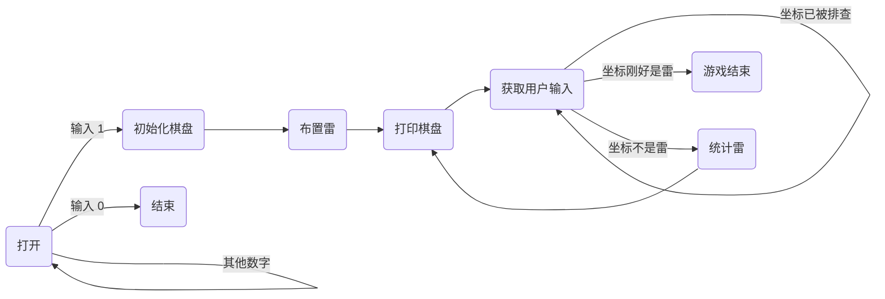

# 引言
~~一个大一新生的浅谈~~
我的[gitee仓库](https://gitee.com/warm-flame-core)记录了我的作业和简单算法，还有博客的markdown原文，扫雷游戏的代码也上传到仓库，欢迎各位学习

学了那么久C语言了，是时候写一点好玩的东西~~取悦自己~~ 了，还没学指针，打算用数组和函数的知识做一款纯数字版本的扫雷游戏吧.
这个游戏需要学习函数，数组，多文件。没有用到数组和递归（递归是为了展开空格子）
<center><font color="red">注：这个扫雷目前无法展开空格子，因为写稿时尚未学习递归，请读者见谅</font></center>

# 目标
- 使用控制台实现数字版的扫雷
- 游戏有菜单，可以继续玩或者退出
- 除了不能自动展开附近的空格子，实现其他功能
# 原理设想
对于一个9×9格子的扫雷游戏，我们可以用二维数组的形式展示，创建一个mine[9][9]数组，其中0代表没有雷，1代表有雷

但是这会有两个问题：

 - 当我对一个格子进行扫雷的时候，需要统计这个格子周围有几个雷，如果周围恰好时一个雷时，这个`1`在数组里是表示周围有一个雷，还是表示这个格子是雷呢
 - 为了设计方便，我们在判定周围有几个雷的时候用循环去遍历这个格子周围的所有格子，但是当需要判定格子位于边界的时候，再去遍历格子就会出现<font color="red">**数组越界**</font>

对于前者，我们可以设置两个两个数组，一个数组show用于展示给用户的，每个元素初始化都设置为`*`。另一个数组mine用于存放雷的信息，但是为了两个数组能用同一个函数进行操作，mine数组我们用字符`1`表示雷，字符`0`表示没有雷

对于后者，我们可以扩充数组，为边界也设置元素，这样在遍历时就不会越界，同时初始化的时候为mine数组的每个元素初始化为`"0"`，show数组的每个元素初始化为`"*"`，如示例：

```c
	char mine[11][11];			//mine数组用来储存雷的信息
	char show[11][11];			//show数组用于给用户展示信息
```
# 多文件
在学习多文件之后，为了让我们的代码跟具备可读性，我们可以设置三个文件

> game.h&nbsp;&nbsp;&nbsp;&nbsp;&nbsp;&nbsp;&nbsp;&nbsp;&nbsp;&nbsp;&nbsp;声明函数和定义一些数 
> game.c&nbsp;&nbsp;&nbsp;&nbsp;&nbsp;&nbsp;&nbsp;&nbsp;&nbsp;&nbsp;&nbsp;实现函数 
> test.c&nbsp;&nbsp;&nbsp;&nbsp;&nbsp;&nbsp;&nbsp;&nbsp;&nbsp;&nbsp;&nbsp;&nbsp;&nbsp;&nbsp;逻辑实现

# 函数实现

## 整体逻辑


```c
int main()
{
	test();
	return 0;
}
```
其中，在**test**函数里
我们需要完成我们的整体逻辑实现：

 1. 获取用户输入
 2. 判断用户输入，进行对应操作
 3. 每次都要打印菜单

对于菜单，我们可以简单封装一个没有返回类型的menu函数

```c
void menu()
{
	printf("***************************\n");
	printf("********   扫雷   *********\n");
	printf("********  1.play  **********\n");
	printf("********  0.exit  **********\n");
	printf("***************************\n");
}
```
基于目标，我们发现每次玩游戏之前都需要打印菜单，那么就可以用do-while结构。在do里面获取用户的输入值（`input`），平且使用switch语句，用1进行游戏，0退出游戏，default用来告诉用户输入错误重新选择。在while里就可以放`input`，当用户输入0,即不想玩了，此时while条件为假，函数不再执行，就可以结束。

```c
void test()
{
	int input = 0;
	srand((unsigned int)time(NULL));
	do
	{
		menu();
		printf("请选择（输入对应数字后按下enter）");
		scanf("%d", &input);				//获取用户输入
		switch (input)
		{
		case 1:
			game();				//开玩！！！！！！！！！！！！！！       扫雷，启动！
			break;
		case 0:
			printf("拜拜了\n");
			break;
		default:
			printf("输入错误，请重新输入\n");
			break;
		}
	} while (input);
	
}
```
接下来我们就要开始实现开始游戏的逻辑了。
## 声明一些数字
为了后续方便修改，比如扩充棋盘，增加雷的数量，我们需要定义一些数字，比如：

> 棋盘展示的行和列——`ROW`和`COL` 
> 棋盘实际的行和列——`ROWs`和`COLS` 
> 雷的数量————`EASY_COUNT`

这样先定义的好处是当我门需要修改一些数字的时候，只需要修改定义数字的地方就可以了，十分方便，***易维护性***

```c
#define ROW 9		//定义行数
#define COL 9		//定义列数

#define ROWS ROW+2
#define COLS COL+2
#define EASY_COUNT 10		//定义雷数
```
这些声明数字和声明函数一样，我们都放到`game.h`里面
<br>
<br>
<br>
接下就要在game()函数里实现扫雷了
首先需要创建两个数组

```c
	char mine[ROWS][COLS];
	char show[ROWS][COLS];
```

## 初始化棋盘
根据原理猜想，我们需要对两个数组里面的每一个元素放上`字符0`或者`*`。
函数声明：

```c
//初始化棋盘函数
void InitBorad(char arr[ROWS][COLS], int rows, int cols, char set);
```
传入二维数组作为参数，其中小写`rows`，`cols`表示我们要控制的行和列，`set`表示我们要输入的字符
<br>
用两层循环嵌套实现对二位数组的初始化，第一层控制行，第二层控制每行的每一列

```c
//初始化棋盘函数
void InitBorad(char arr[ROWS][COLS], int rows, int cols, char set)
{
	int i = 0;
	for (i = 0; i < rows; i++)
	{
		int j = 0;
		for (j = 0; j < cols; j++)
		{
			arr[i][j] = set;
		}
	}
}
```
## 打印棋盘
按逻辑应该是要布置雷了，但是为了检验我们初始化对不对，我们可以先写一个打印棋盘的函数验证一些我们初始化的对不对
函数声明：

```c
//打印棋盘
void DisplayBorad(char arr[ROWS][COLS], int row, int col);
```
传入二维数组作为参数，其中小写`rows`，`cols`表示我们要控制的行和列
<br>
同样的，用两层循环嵌套实现对二位数组的打印，第一层控制行，第二层控制每行的每一列

```c
//打印棋盘函数
void DisplayBorad(char arr[ROWS][COLS], int row, int col)
{
	for (i = 1; i <= row; i++)
	{
		int j = 0;
		for (j = 1; j <= col; j++)
		{
			printf("%c   ", arr[i][j]);
		}
		printf("\n");
	}
}
```

> 这个函数两个数组都可以打印，只需要控制传入的参数就可以了，在测试的时候十分方便，***易维护性***

但是这样打印出来的棋盘不够人性化，因为没有标注行和列，再扫雷的时候用户还得自己数在哪行哪列。


所以我们可以在棋盘左边和上边加上行号和列号，在美化一下

```c
//打印棋盘函数
void DisplayBorad(char arr[ROWS][COLS], int row, int col)
{
	int i = 0;
	printf("------------扫雷--------------\n");
	for (i = 0; i <= row; i++)
	{
		printf("%d - ", i);
	}
	printf("\n");

	for (i = 1; i <= row; i++)
	{
		printf("%d | ", i);
		int j = 0;
		for (j = 1; j <= col; j++)
		{
			printf("%c   ", arr[i][j]);
		}
		printf("\n");
	}
}
```
打印出来就好看多了

<br>
将初始化棋盘和打印棋盘组合起来使用，测试发现两个数组初始化都正确，这说明我们的代码没有错误
## 布置雷
扫雷有随机性，所以我们布置雷的时候还需要保证每一局的雷是不一样的，这需要我们用随机数控制mine数组的元素，抽到的元素由`字符0`改成`字符1`。在C语言中，生成随机数需要用`rand();`。但是单独用`rand();`生成的是***伪随机数***,我们需要每一局时修改随机数的`“种子”`，即`srand();`。试想一下，什么东西是一直在变化的，当然是<font color="red">**时间**</font>，我们可以将时间作为参数传入`srand();`。
同时我们需要修改test函数，在打菜单前修改一次种子：

```c
	srand((unsigned int)time(NULL));
```

time函数传入`NULL`是空指针的意思，~~至于为什么——没学~~ 。需要将time函数的结果进行装置类型转换，不然编译器会报警告：


<br>
<br>
<br>
其中：

 - 生成随机数我们需要头文件——`stdlib.h` 
 - 用时间作为参数我们需要头文件——`time.h`

函数声明：

```c
//布置雷
void SetMine(char arr[ROWS][COLS], int row, int col);
```
布置雷我们只需要对mine数组进行操作，所以使用函数的时候只需要传入mine数组
在函数内创建变量`x`,`y`，用`rand();`对`9`求余就能得到`0 ~ 8`的数字，在`+1`就可以得到`1 ~ 9`的数字
创建变量`count`，作为一个`while`循环的条件，当随机生成的`mine [ x ] [ y ] == "0"`时，就将`mine [ x ] [ y ]`的值改成`"1"`。即表示布置雷，同时`count --`。这样的循环至少进行10次，确保一定能布置到十个雷。

```c
//布置雷函数
void SetMine(char arr[ROWS][COLS], int row, int col)
{
	int count = EASY_COUNT;
	while (count)
	{
		int x = rand() % row + 1;
		int y = rand() % col + 1;
		
		if (arr[x][y] == '0')
		{
			arr[x][y] = '1';
			count--;
		}
	}
}
```
## 排查雷
当一切准备都做好的时候，我们需要给用户打印`show`数组，并获取用户的输入坐标，对坐标进行判断，根据流程，我们需要判断：

 1. 坐标是否越界
 2. 坐标是否已被排查
 3. 坐标是否是雷
 4. 坐标不是雷，周围几个雷

这四个问题我们发现需要我们结合两个数组来判断，其中用`show`数组的`"*"`判断是否已经被排查，用`mine`数组的`"1"`和`"0"`判断有没有被炸死或者周围几个雷，所以我们需要给函数传入两个数组
函数声明：

```c
//排雷
void FindMine(char mine[ROWS][COLS], char show[ROWS][COLS], int row, int col);
```
上述四个问题可以用if嵌套来判断：
- 用数字大小判断是否越界
- 坐标 `==`   `*`的时候该坐标已被排查
- 坐标 `==`   `1`的时候被炸死
- 坐标 `==`    `0`的时候判断周围几个雷

用while循环承接每次的排雷，同时创建一个变量`over`,其值等于0，当坐标不是的时候就+1，让while的条件为`over < row * col - EASY_COUNT`表示每成功排一次就记录一次次数，当次数大于等于空格子数量表示已经排完了。

```c
//排雷函数
void FindMine(char mine[ROWS][COLS], char show[ROWS][COLS], int row, int col)
{
	int x = 0;
	int y = 0;
	int over = 0;
	while (over < row * col - EASY_COUNT)
	{
		printf("(两个坐标之间请用空格隔开,输入后请按回车)\n");
		printf("请输入要排查的雷的坐标> ");
		scanf("%d %d", &x, &y);
		if (x > 0 && x <= row && y > 0 && y <= row)
		{
			if (mine[x][y] == '1')
			{
				printf("\n\n\n");
				printf("运气太好了，你被炸死了\n");
				printf("数字1代表雷，数字0代表不是雷\n");
				DisplayBorad(mine, ROW, COL);
				break;
			}
			else
			{
				if (show[x][y] != '*')
				{
					printf("此坐标已被排查，请重新输入\n");
				}
				else
				{
					int count = 0;
					count = GetMineCount(mine, x, y);
					show[x][y] = count + '0';
					DisplayBorad(show, ROW, COL);
					over++;
				}
			}
		}
		else
		{
			printf("坐标非法，请重新输入\n");
		}
	}
	if (over == row * col - EASY_COUNT)
	{
		printf("排完了，全是运气，没有实力\n");
		DisplayBorad(mine, ROW, COL);
	}
}
```
## 获取周边格子雷的个数
在排查雷函数中，对于次坐标不是雷，我们需要只要周边格子都是雷，最简单的方式就是遍历周边所有格子，有雷的就+1，但是这样有点难实现，因为我们的棋盘是字符型的，字符相加减会出问题，那么就可以思考：既然是字符，那么我们应该可以用**ASCII编码**。
在ASCII编码中：
- **`字符1`减去`字符0`等于`数字1`**
- **`字符0`减去`字符0`等于`数字0`**
我们就遍历周围所有格子，包括自己（在前面已经判断过此坐标不是雷，那么数组元素就是`字符0`，加上这个`字符0`不影响结果）把所有格子的`字符`加起来减去`九个字符0`，就能得到周边格子雷的个数，而且是数字形式的，函数返回这个值就可以了。

```c
int GetMineCount(char arr[ROWS][COLS],int x,int y)
{
	int mine_count = 0;
	int i = 0;
	for (i = x-1; i <= x+1; i++)
	{
		int j = 0;
		for (j = y - 1; j <= y + 1; j++)
		{
			mine_count += arr[i][j];
		}
	}
	return mine_count - '0' * 9;
}
```
函数返回值在排查雷的函数中用一个整型变量`count`承接，在加上一个`字符0`使其变回字符类型，再传回数组对应元素就可以实现获取周边格子雷的个数。

```c
int count = 0;
count = GetMineCount(mine, x, y);
show[x][y] = count + '0';
```
<center><font color="red">这个方法十分巧妙，可以实现字符数字和整形数字的转换。</font></center>

# 串起来
最后用`game();`函数将所有函数串起来

```c
void game()  //扫雷游戏逻辑
{
	char mine[ROWS][COLS];
	char show[ROWS][COLS];

	//初始化棋盘
	InitBorad(mine, ROWS, COLS, '0');
	InitBorad(show, ROWS, COLS, '*');

	//布置雷
	SetMine(mine, ROW, COL);
	
	//打印棋盘
	//DisplayBorad(mine, ROW, COL);
	//DisplayBorad(show, ROW, COL);

	//开始排查雷
	DisplayBorad(show, ROW, COL);
	FindMine(mine, show, ROW, COL);
}
```
美化一下界面，加入等待时间。等待时间用`Sleep();`函数，其中函数参数表示要等待的毫秒，需要包含头文件`Windows.h`。
# 结语
后续会加入递归，实现自动展开空格子
# 源码
game.h

```c
#pragma once
#include<stdio.h>
#include<stdlib.h>
#include<Windows.h>
#include<time.h>

#define ROW 9		//定义行数
#define COL 9		//定义列数

#define ROWS ROW+2
#define COLS COL+2
#define EASY_COUNT 10		//定义雷数

//声明函数

//初始化棋盘
void InitBorad(char arr[ROWS][COLS], int rows, int cols, char set);

//打印棋盘
void DisplayBorad(char arr[ROWS][COLS], int row, int col);

//布置雷
void SetMine(char arr[ROWS][COLS], int row, int col);

//排雷
void FindMine(char mine[ROWS][COLS], char show[ROWS][COLS], int row, int col);
```
<br>
<br>
<br>
game.c

```c
#define _CRT_SECURE_NO_WARNINGS 1
#include"game.h"

//初始化棋盘函数
void InitBorad(char arr[ROWS][COLS], int rows, int cols, char set)
{
	int i = 0;
	for (i = 0; i < rows; i++)
	{
		int j = 0;
		for (j = 0; j < cols; j++)
		{
			arr[i][j] = set;
		}
	}
}

//打印棋盘函数
void DisplayBorad(char arr[ROWS][COLS], int row, int col)
{
	int i = 0;
	printf("------------扫雷--------------\n");
	for (i = 0; i <= row; i++)
	{
		printf("%d - ", i);
	}
	printf("\n");

	for (i = 1; i <= row; i++)
	{
		printf("%d | ", i);
		int j = 0;
		for (j = 1; j <= col; j++)
		{
			printf("%c   ", arr[i][j]);
		}
		printf("\n");
	}
}

//布置雷函数
void SetMine(char arr[ROWS][COLS], int row, int col)
{
	int count = EASY_COUNT;
	while (count)
	{
		int x = rand() % row + 1;
		int y = rand() % col + 1;
		
		if (arr[x][y] == '0')
		{
			arr[x][y] = '1';
			count--;
		}
	}
}

static int GetMineCount(char arr[ROWS][COLS],int x,int y)
{
	int mine_count = 0;
	int i = 0;
	for (i = x-1; i <= x+1; i++)
	{
		int j = 0;
		for (j = y - 1; j <= y + 1; j++)
		{
			mine_count += arr[i][j];
		}
	}
	return mine_count - '0' * 9;
}

//排雷函数
void FindMine(char mine[ROWS][COLS], char show[ROWS][COLS], int row, int col)
{
	int x = 0;
	int y = 0;
	int over = 0;
	while (over < row * col - EASY_COUNT)
	{
		printf("(两个坐标之间请用空格隔开,输入后请按回车)\n");
		printf("请输入要排查的雷的坐标> ");
		scanf("%d %d", &x, &y);
		if (x > 0 && x <= row && y > 0 && y <= row)
		{
			if (mine[x][y] == '1')
			{
				printf("\n\n\n");
				printf("运气太好了，你被炸死了\n");
				printf("数字1代表雷，数字0代表不是雷\n");
				DisplayBorad(mine, ROW, COL);
				printf("请等待加载\n");
				Sleep(5000);
				break;
			}
			else
			{
				if (show[x][y] != '*')
				{
					printf("此坐标已被排查，请重新输入\n");
				}
				else
				{
					int count = 0;
					count = GetMineCount(mine, x, y);
					show[x][y] = count + '0';
					DisplayBorad(show, ROW, COL);
					over++;
				}
			}
		}
		else
		{
			printf("坐标非法，请重新输入\n");
		}
	}
	if (over == row * col - EASY_COUNT)
	{
		printf("排完了，全是运气，没有实力\n");
		DisplayBorad(mine, ROW, COL);
		printf("请等待加载");
		Sleep(5000);
	}
}
```
<br>
<br>
<br>
test.c

```c
#define _CRT_SECURE_NO_WARNINGS 1
#include"game.h"

void menu()
{
	printf("***************************\n");
	printf("********   扫雷   *********\n");
	printf("********  1.play  **********\n");
	printf("********  0.exit  **********\n");
	printf("***************************\n");
}

void game()  //扫雷游戏逻辑
{
	char mine[ROWS][COLS];
	char show[ROWS][COLS];

	//初始化棋盘
	InitBorad(mine, ROWS, COLS, '0');
	InitBorad(show, ROWS, COLS, '*');

	//布置雷
	SetMine(mine, ROW, COL);
	
	//打印棋盘
	//DisplayBorad(mine, ROW, COL);
	//DisplayBorad(show, ROW, COL);

	//开始排查雷
	DisplayBorad(show, ROW, COL);
	FindMine(mine, show, ROW, COL);
}

void test()
{
	int input = 0;
	srand((unsigned int)time(NULL));
	do
	{
		printf("请等待加载（2秒+…………………………………………）\n");
		Sleep(2000);
		menu();
		printf("请选择（输入对应数字后按下enter）");
		scanf("%d", &input);
		switch (input)
		{
		case 1:
			game();
			break;
		case 0:
			printf("拜拜了\n");
			break;
		default:
			printf("输入错误，请重新输入\n");
			break;
		}
	} while (input);
	
}

int main()
{
	test();
	return 0;
}
```

---

## 相关笔记 / 相关链接

- 相关目录：[[C语言目录]]
- 相关笔记：[[C语言/初识C语言]]（前置：基础语法）、[[C语言/用贪吃蛇复习C语言]]（同类：综合练习）

