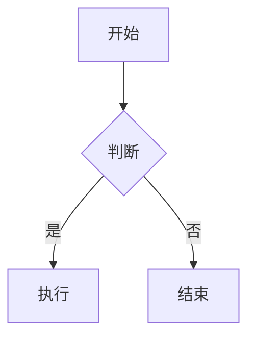
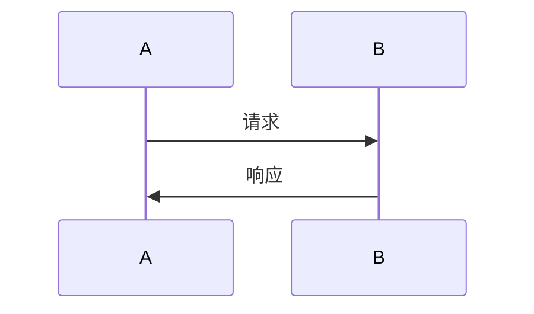

# Obsidian 的 MD 语法

| 项目 | 内容 |
| --- | --- |
| 文档版本 | v2.2 |
| 最后更新 | 2026-09-13 |
| Obsidian 版本 | 1.13.7（installer 1.12.7） |
| CSDN 实测日期 | 2026-09-13 |
| 实测方式 | CSDN 编辑器粘贴渲染测试 |

本文档是**写作助手的使用说明**，不是博客内容。用途有两个：

1. 写博客时决定用什么语法表达；
2. 定稿后生成「CSDN 替换清单」时查对照表。

博客在 Obsidian 里写、在 CSDN 发布，两边语法支持不同。本文档收录**全部标准语法与 Obsidian 特有语法的写法示例**，并标注 CSDN 实测结果。

> **时效提醒**：CSDN 与 Obsidian 都会更新，平台支持情况可能变化。
> 本文档的 CSDN 结论以实测日期为准，**超过半年建议重新验证**再依赖结论。
> 更新时请同步修订顶部信息表和 4.4 变更记录。

**图例**：✅ 支持 ｜ ⚠️ 部分支持 ｜ ❌ 不支持（原样显示为文字）

---

## 目录

**一、标准语法**（Obsidian 与 CSDN 都支持）

- 1.1 标题　1.2 文字样式　1.3 无序列表　1.4 有序列表　1.5 嵌套列表　1.6 任务列表
- 1.7 引用块　1.8 嵌套引用　1.9 引用块内放列表与代码
- 1.10 表格　1.11 表格对齐
- 1.12 代码块（标注语言）　1.13 代码块（不标注语言）　1.14 分隔线
- 1.15 链接　1.16 图片　1.17 HTML 标签　1.18 转义字符

**二、Obsidian 特有语法**（CSDN 多数不支持，用了要列替换清单）

- 链接类：2.1 双链　2.2 双链带别名　2.3 标题锚点　2.4 块引用　2.5 笔记内锚点
- 嵌入类：2.6 图片嵌入　2.7 图片嵌入指定宽度　2.8 笔记嵌入　2.9 PDF 页嵌入
- 样式类：2.10 高亮　2.11 注释　2.12 行内标签　2.13 嵌套标签
- 注记类：2.14 编号脚注　2.15 行内脚注
- 公式与图：2.16 行内公式　2.17 块级公式　2.18 Mermaid 流程图　2.19 Mermaid 时序图
- 标注块：2.20 标注块　2.21 自定义标题　2.22 标注块类型　2.23 可折叠标注块　2.24 嵌套标注块
- 元数据：2.25 YAML 属性　2.26 块 ID

**三、CSDN 替换转换表**　**四、实测记录**　**五、写作建议**

---

## 一、标准语法

Obsidian 与 CSDN 都支持，博客里可以放心用。本节每项给出**写法示例**和 **CSDN 实测结果**。

### 1.1 标题

```markdown
# 一级标题
## 二级标题
### 三级标题
#### 四级标题
##### 五级标题
###### 六级标题
```

CSDN：✅ 实测四级到六级均正常 ｜ 标题层级不得跳级。

### 1.2 文字样式

```markdown
**加粗文字**
*斜体文字*
***加粗斜体***
~~删除线~~
`行内代码`
```

CSDN：✅ 实测正常（含删除线）

### 1.3 无序列表

```markdown
- 项目一
- 项目二

+ 也可以用加号
* 也可以用星号
```

CSDN：✅ ｜ 统一用 `-`，避免三种符号混用。

### 1.4 有序列表

```markdown
1. 第一步
2. 第二步
3. 第三步
```

CSDN：✅

### 1.5 嵌套列表

```markdown
- 一级
  - 二级
    - 三级

1. 一级
   1. 二级
```

CSDN：✅ 实测无序列表三级嵌套、有序列表嵌套均正常 ｜ 缩进用两个空格。

### 1.6 任务列表

```markdown
- [ ] 未完成
- [x] 已完成
```

CSDN：✅

### 1.7 引用块

```markdown
> 引用内容
> 可以连续多行
>
> 也可以分段
```

CSDN：✅

### 1.8 嵌套引用

```markdown
> 外层引用
> > 内层引用
```

CSDN：✅ 实测正常

### 1.9 引用块内放列表与代码

```markdown
> 引用中的列表：
> - 项目一
> - 项目二
>
> 引用中的行内代码：`int a = 1;`
```

CSDN：✅ 实测正常

### 1.10 表格

```markdown
| 表头一 | 表头二 |
| --- | --- |
| 内容一 | 内容二 |
```

CSDN：✅

### 1.11 表格对齐

```markdown
| 左对齐 | 居中 | 右对齐 |
| :--- | :---: | ---: |
| A | B | C |
```

CSDN：✅ ｜ 表格内竖线需转义写成 `\|`。

### 1.12 代码块（标注语言）

````markdown
```cpp
int main()
{
    return 0;
}
```
````

CSDN：✅ ｜ 代码块必须标注语言。

### 1.13 代码块（不标注语言）

````markdown
```
纯文本代码块
   保留了缩进
```
````

CSDN：✅ 实测正常 ｜ 仍建议尽量标注语言。

### 1.14 分隔线

```markdown
上方内容

---

下方内容
```

CSDN：✅ ｜ 单行 `---`，前后各留一个空行。

### 1.15 链接

```markdown
[显示文字](https://example.com)
```

CSDN：✅

### 1.16 图片

```markdown

```

CSDN：✅ ｜ 这是发布时的格式；Obsidian 里写库内图片用 2.6 的嵌入语法。

### 1.17 HTML 标签

```html
<div align="center">居中内容</div>

<font color="#FF69B4">彩色文字</font>

<b style="color: red;">自定义样式</b>
```

CSDN：✅ ｜ 模板头部在用它，不要擅自改成 Markdown 链接。

### 1.18 转义字符

```markdown
\*这不是斜体\*
\`这不是代码\`
\|表格里的竖线\|
```

CSDN：✅ 实测正常（表格内竖线转义也正常）

---

## 二、Obsidian 特有语法

在 Obsidian 里全部正常渲染（Obsidian 是这些语法的实现方），但**CSDN 多数不支持**。使用后必须在「CSDN 替换清单」里列出。

### 链接类

> 说明：双链、标题锚点、块引用这类语法依赖 Obsidian 的链接解析，CSDN 没有对应机制，**一律按不支持处理**。

#### 2.1 双链

```markdown
[[笔记名]]
[[目录/C++目录]]
```

作用：指向库内笔记，自动建立反链，是知识图谱的基础。
CSDN：❌ 原样显示为 `[[笔记名]]`，**必须替换**。

#### 2.2 双链带别名

```markdown
[[笔记名|显示文本]]
[[目录/C++目录|C++ 目录]]
```

CSDN：❌ 原样显示 ｜ 替换时保留「显示文本」即可。

#### 2.3 标题锚点

```markdown
[[笔记名#某节标题]]
[[继承全解——继承、默认成员函数、切片、隐藏与虚继承#切片]]
```

作用：跳到目标笔记的指定小节。
CSDN：❌ 按不支持处理（依赖 Obsidian 链接解析）。

#### 2.4 块引用

```markdown
[[笔记名#^块ID]]
```

作用：跳到目标笔记里被 `^块ID` 标记的具体段落。
CSDN：❌ 按不支持处理。

#### 2.5 笔记内锚点

```markdown
[[#本笔记里的某节标题]]
```

作用：在**当前笔记内**跳转到指定小节，用于长文的目录。
CSDN：❌ 按不支持处理 ｜ 长文目录改用手写序号。

> 注：本文档顶部的目录用的是普通文字列表，没有用锚点链接，就是为了发布时不用替换。

### 嵌入类

#### 2.6 图片嵌入

```markdown
![[STM32/attachments/STM32命名拆解.png]]
```

作用：显示库内图片，是写博客真图的主要方式。
CSDN：❌ 原样显示，**必须替换**成 ``。

#### 2.7 图片嵌入指定宽度

```markdown
![[STM32命名拆解.png|300]]
![[STM32命名拆解.png|300x200]]
```

作用：限制显示宽度（或宽×高），只影响显示不影响原图。
CSDN：❌ 按不支持处理（外层 `![[...]]` 已证实原样显示）｜ 替换时宽度交给 CSDN 处理。

#### 2.8 笔记嵌入

```markdown
![[另一篇笔记]]
![[另一篇笔记#某节]]
```

作用：把整篇笔记（或其中一节）的内容嵌进当前笔记显示。
CSDN：❌ 按不支持处理。

#### 2.9 PDF 页嵌入

```markdown
![[文档.pdf#page=3]]
```

作用：嵌入 PDF 的指定页。
CSDN：❌ 按不支持处理 ｜ 博客里基本用不到。

### 样式类

#### 2.10 高亮

```markdown
这是一段 ==高亮文本==。
```

CSDN：⚠️ **支持，但只有黄色**，没有其他颜色可选。

#### 2.11 注释

```markdown
这段可见，%%这段在阅读视图里被隐藏%% 这段也可见。

%%
整块隐藏的内容。
%%
```

作用：写作时的私人批注，阅读视图不显示。
CSDN：⚠️ 文本会显示出来（CSDN 没有隐藏注释机制），**发布前必须删除**。

#### 2.12 行内标签

```markdown
#标签
```

作用：Obsidian 内的分类标记，可被搜索和聚合。
CSDN：❌ 原样显示为文字，**必须替换**（删除或改成普通描述）。

#### 2.13 嵌套标签

```markdown
#编程/嵌入式
#编程/STM32
```

作用：层级标签，斜杠表示层级。
CSDN：❌ 按不支持处理（`#tag` 已被证实原样显示，嵌套标签同理）。

### 注记类

#### 2.14 编号脚注

```markdown
这里有一个脚注[^1]。

[^1]: 脚注内容写在这里。
```

CSDN：✅ 支持。

#### 2.15 行内脚注

```markdown
这里有行内脚注。^[直接写在行内的脚注内容。]
```

CSDN：✅ 实测正常

### 公式与图

#### 2.16 行内公式

```markdown
质能方程 $E = mc^2$，算法复杂度 $O(n \log n)$。
```

CSDN：✅ 支持（LaTeX 语法）。

#### 2.17 块级公式

```markdown
$$
\frac{a}{b} = c
$$
```

CSDN：✅ 支持。

#### 2.18 Mermaid 流程图

````markdown

````

CSDN：✅ 支持。

#### 2.19 Mermaid 时序图

````markdown

````

CSDN：✅ 实测正常

### 标注块

#### 2.20 标注块基础写法

```markdown
> [!note]
> 这是 note 类型标注块。
```

作用：彩色提示框，用于强调、警告、提示等。
CSDN：❌ **不支持，显示异常，必须替换**。

#### 2.21 标注块自定义标题

```markdown
> [!warning] 自定义标题
> 这是 warning 类型，带自定义标题。
```

CSDN：❌ 不支持 ｜ 替换为 `> **自定义标题**` + 换行 `> 内容`。

#### 2.22 标注块类型

```markdown
> [!note]     备注
> [!tip]      提示
> [!info]     信息
> [!warning]  警告
> [!danger]   危险
> [!success]  成功
> [!failure]  失败
> [!question] 疑问
> [!example]  示例
> [!quote]    引用
> [!bug]      Bug
> [!todo]     待办
> [!abstract] 摘要
```

CSDN：❌ 全部不支持。

#### 2.23 可折叠标注块

```markdown
> [!faq]- 默认折叠
> 点开才能看到的内容。

> [!faq]+ 默认展开
> 默认就能看到的内容。
```

作用：`-` 表示默认折叠，`+` 表示默认展开。
CSDN：❌ 原样显示，**必须替换**（删掉 `-`/`+`，折叠效果会丢失）。

#### 2.24 嵌套标注块

```markdown
> [!note]
> 外层内容
> > [!tip]
> > 内层内容
```

CSDN：❌ 不支持。

### 元数据

#### 2.25 YAML 属性（frontmatter）

```markdown
---
tags:
  - 嵌入式
aliases:
  - STM32概念篇
日期: 2026年9月13日
---
```

作用：笔记的元数据，用于搜索、别名、归档。
CSDN：发布时删除（CSDN 有自己的标签系统）。

#### 2.26 块 ID

```markdown
这一行后面定义了块 ID。^block-test
```

作用：给段落一个可被引用的标识（配合 2.4 块引用使用）。
CSDN：不用于发布。

---

## 三、CSDN 替换转换表

生成「CSDN 替换清单」时按这张表给出建议写法。

### 3.1 链接类

| Obsidian 写法 | 建议替换 | 说明 |
| --- | --- | --- |
| `[[笔记]]` | 删掉，或改成普通文字 | 正文里通常直接提到概念名即可 |
| `[[笔记\|显示文本]]` | 保留「显示文本」 | 去掉方括号部分 |
| `[[笔记#标题]]` | 改成普通文字或删掉 | 跳转失效 |
| `[[笔记#^块ID]]` | 删掉 | |
| `[[#本笔记某节]]` | 删掉，或改成普通小节名 | 长文目录会失效，建议改成手写序号 |

### 3.2 嵌入类

| Obsidian 写法 | 建议替换 | 说明 |
| --- | --- | --- |
| `![[图片.png]]` | `` | **上传 CSDN 图床后拿到 URL 替换** |
| `![[图片.png\|300]]` | `` | 宽度交给 CSDN 处理 |
| `![[笔记]]` | 把内容复制过来，或删掉 | 嵌入关系丢失 |
| `![[文档.pdf#page=3]]` | 改成截图上传 | |

### 3.3 样式与标注

| Obsidian 写法 | 建议替换 | 说明 |
| --- | --- | --- |
| `==文字==` | 保留 | CSDN 支持，只是仅黄色 |
| `%%注释%%` | 删除 | 本就不该发布 |
| `#标签` | 删除 | 或改成正文里的普通描述 |
| `#编程/嵌入式` | 删除 | |
| `> [!note] 标题` | `> **标题**` + 换行 `> 内容` | 用普通引用块加粗标题替代 |
| `> [!warning]` / `> [!tip]` 等 | 同上 | 图标会丢失，用文字提示 |
| `> [!faq]- 标题` | 同上，删掉 `-` | 折叠效果丢失 |

### 3.4 注记与公式

| Obsidian 写法 | 建议替换 | 说明 |
| --- | --- | --- |
| `[^1]` 编号脚注 | 保留 | CSDN 支持 |
| `^[行内脚注]` | 保留 | CSDN 支持（实测正常） |
| `$公式$` / `$$公式$$` | 保留 | CSDN 支持 |
| Mermaid 代码块 | 保留 | CSDN 支持（流程图与时序图均正常） |

### 3.5 元数据

| Obsidian 写法 | 建议替换 | 说明 |
| --- | --- | --- |
| YAML frontmatter | 删除 | 发布时不需要 |
| `^块ID` | 删除 | |

---

## 四、实测记录

### 4.1 CSDN 实测汇总（实测于 2026-09-13）

**标准语法：全部支持（✅）**

| 语法 | 实测结果 |
| --- | --- |
| 标题（含四级到六级） | ✅ 正常 |
| 加粗 / 斜体 / 删除线 / 行内代码 | ✅ 正常 |
| 无序列表（三级嵌套） | ✅ 正常 |
| 有序列表（含嵌套） | ✅ 正常 |
| 任务列表 | ✅ 正常 |
| 引用块、嵌套引用 | ✅ 正常 |
| 引用块内放列表与代码 | ✅ 正常 |
| 表格、表格对齐 | ✅ 正常 |
| 表格内竖线转义 `\|` | ✅ 正常 |
| 代码块（标注语言 / 不标注语言） | ✅ 均正常 |
| 分隔线 | ✅ 正常 |
| 链接、图片 | ✅ 正常 |
| HTML 标签 | ✅ 正常（模板在用） |
| 转义字符 | ✅ 正常 |

**特有语法：分三类**

| 语法 | 结果 | 处理 |
| --- | --- | --- |
| 高亮 `==文字==` | ⚠️ 支持，仅黄色 | 可直接用 |
| 行内公式 / 块级公式 | ✅ 支持 | 可直接用 |
| Mermaid 流程图 / 时序图 | ✅ 支持 | 可直接用 |
| 编号脚注 / 行内脚注 | ✅ 支持 | 可直接用 |
| 标注块 `> [!note]` | ❌ 显示异常 | **必须替换** |
| 可折叠标注块 `> [!faq]-` | ❌ 原样显示 | **必须替换** |
| 标签 `#标签` | ❌ 原样显示 | **必须替换** |
| 双链 `[[...]]` | ❌ 原样显示 | **必须替换** |
| 图片嵌入 `![[...]]` | ❌ 原样显示 | **必须替换** |
| 注释 `%%...%%` | ⚠️ 内容会显示 | 发布前删除 |
| 标题锚点 / 块引用 / 笔记内锚点 | ❌ 依赖 Obsidian 解析 | 按不支持处理 |
| 笔记嵌入 / PDF 页嵌入 | ❌ 同上 | 按不支持处理 |
| 图片嵌入带宽度 | ❌ 同上 | 按不支持处理 |
| 嵌套标签 | ❌ 同上 | 按不支持处理 |
| YAML 属性 | — | 发布时删除 |
| 块 ID | — | 不用于发布 |

**结论**：**链接/嵌入/标注块/标签类必须替换；公式、Mermaid、脚注、高亮可以放心用。**

> 上述结论来自 2026-09-13 两轮实测（第一轮 12 项、第二轮 20 项）。
> 平台可能更新，超过半年建议重新验证。

### 4.2 Obsidian 侧

| 项目 | 结果 |
| --- | --- |
| Obsidian 版本 | 1.13.7（installer 1.12.7） |
| 全语法支持 | ✅ 全部正常（标注块、折叠块、双链、嵌入、公式、Mermaid、脚注、块引用均正常） |
| 验证方式 | 语法测试文件逐项渲染确认 |

Obsidian 是这套语法的实现方，本身不存在"部分支持"；真正需要关注的是**导出到 CSDN 后的差异**，即 4.1。

### 4.3 变更记录

| 日期 | 版本 | 变更内容 |
| --- | --- | --- |
| 2026-09-13 | v1.0 | 首版建立：整理标准语法与 Obsidian 特有语法，完成 CSDN 实测，补充转换表与写作建议 |
| 2026-09-13 | v2.0 | 补充全部语法的具体写法示例（标准语法 18 项、特有语法 26 项）；增加目录便于检索；转换表按类型重组；实测记录拆分汇总 |
| 2026-09-13 | v2.1 | 修正实测结果：标准语法 18 项全部标记为支持（此前误标 9 项为"未实测"）；特有语法补齐结论；4.1 改为按标准/特有分类汇总 |
| 2026-09-13 | v2.2 | 用户复核四级到六级标题、嵌套引用、引用块内列表与代码、行内脚注、Mermaid 时序图、转义字符、表格竖线转义，确认全部正常；移除图例中的"未实测"标记 |

---

## 五、写作建议

### 5.1 表达方式的选择

**优先用标准语法**，理由有两个：

1. 发布时不用替换，少一道工序；
2. 阅读体验跨平台一致，不会因平台差异走样。

**按内容类型选表达方式**：

| 内容 | 表达方式 |
| --- | --- |
| 代码、命令、配置 | 代码块（标注语言） |
| 结构图、内存布局、指针关系、调用关系、状态变化 | 代码块图示（ASCII 画） |
| 举例子、列要点、讲步骤、做对比 | 列表 / 表格 / 引用块 |
| 实物照片、真实截图、复杂原理图 | 真图（`![[...]]`，发布前替换） |

**不要为了画而画**：把「列要点」硬塞进代码块会显得刻意，列表和表格更适合这类内容。

### 5.2 让文档更易读的写法

博客常犯的问题是语法太单调（通篇只有段落和代码块）。下面这些标准语法都能用，且 CSDN 支持：

- **引用块**（1.7）做提示、摘录、要点强调，比加粗更醒目；
- **表格**（1.10）做对照，比嵌套列表清楚，比如两类事物的差异对比；
- **任务列表**（1.6）做步骤清单或检查表；
- **嵌套列表**（1.5）表达层级关系，替代多层缩进的长段落；
- **分隔线**（1.14）在主题明显切换处做视觉分隔；
- **行内代码**（1.2）标注函数名、变量名、命令、文件名。

**排版细节**：

- 中英文之间加空格，中文用全角标点；
- 代码块必须标注语言；
- 标题层级不跳级；
- 图片要有 alt 描述。

### 5.3 Obsidian 特有语法的使用

**可以用，但要记得替换**。它们能让 Obsidian 里的体验更好（双链织图谱、标注块区分重点、折叠块收纳长内容），代价是发布前多一道替换工序。

**建议**：

- 双链、图片嵌入：**放心用**，它们是知识库的核心价值（图谱、真图管理），替换成本也低；
- 标注块、折叠块：**谨慎用**，CSDN 不支持，替换后样式会明显降级，如果只是强调内容，直接用引用块更省事；
- 标签：**不用于发布内容**，仅在需要 Obsidian 内检索时用；
- 块 ID、笔记嵌入：博客里基本用不到。

**判断原则**：如果某处用标准语法效果一样，优先用标准语法。


